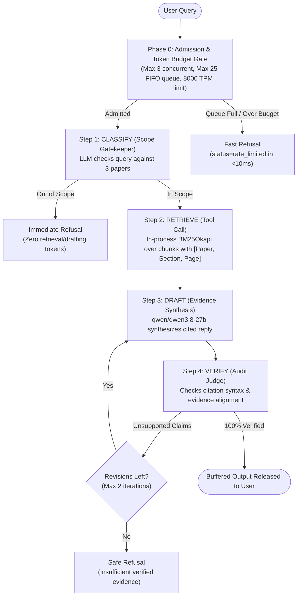

# Passageworks

> **A paper-grounded question-answering pipeline with measured behavior under load.**

Passageworks is an engineering research implementation and empirical load evaluation of an asynchronous, multi-stage research-paper Q&A assistant. The system answers technical questions strictly grounded in three authoritative research papers while enforcing admission control, client-side token budgeting, and closed-loop fact verification under bursty traffic, provider rate limits, and upstream failures.

---

## 1. System Architecture

Passageworks enforces strict knowledge boundaries and evidence traceability across a 4-stage sequential pipeline with concurrency admission control and bounded revision:



### Knowledge Library Boundaries
Evidence is strictly confined to three specific arXiv research papers:
1. **"Attention Is All You Need"** (`arXiv:1706.03762v7`) — Vaswani et al., 2017.
2. **"Moshi: a speech-text foundation model for real-time dialogue"** (`arXiv:2410.00037v1`) — Défossez et al., 2024.
3. **"Dynamic Chunking for End-to-End Hierarchical Sequence Modeling"** (`arXiv:2507.07955v2`) — Yu et al., 2025.

---

## 2. Directory Layout

```
relay/
├── .env.example             # Complete environment configuration template
├── pyproject.toml           # Locked package dependencies and build specification
├── AGENTS.md                # Agent rules, source boundaries, and command specs
├── README.md                # Repository overview, architecture, and quickstart
├── REPORT.md                # Final 2-page synthesis report with Tables 1, 2a, 2b, 3
│
├── src/
│   ├── relay/               # Core Q&A pipeline package
│   │   ├── budget.py        # TokenBudgetTracker (rolling 60s TPM/RPM, daily quota)
│   │   ├── classify.py      # Step 1: Scope gatekeeper and branch gating
│   │   ├── config.py        # PipelineConfig dataclass with environment resolution
│   │   ├── draft.py         # Step 3: Evidence synthesis & inline citation parser
│   │   ├── extract.py       # PDF parser & section-aware passage chunker
│   │   ├── groq_client.py   # GroqClientWrapper (streaming, header extraction, jitter backoff)
│   │   ├── models.py        # Core dataclass contracts & schemas
│   │   ├── pipeline.py      # PassageworksPipeline orchestrator
│   │   ├── queue.py         # AdmissionController (semaphore, bounded queue, deadlines)
│   │   ├── retrieve.py      # In-process Okapi BM25 engine & RetrieverTool
│   │   └── verify.py        # Step 4: Closed-loop fact verification judge
│   │
│   └── relay_standin/       # Calibrated standalone FastAPI mock service
│       ├── config.py        # StandinConfig (calibrated TTFT, jitter, token interval)
│       └── server.py        # Streaming SSE completion routes & control endpoints
│
├── harness/                 # Load generator and empirical calibration suite
│   ├── calibrate_groq.py    # Conservative live Groq quota calibration harness
│   ├── load_runner.py       # Open-loop arrival scheduler (steady, burst, overload)
│   └── questions.jsonl      # 18 authored benchmark questions (13 answerable, 5 traps)
│
├── analysis/                # Telemetry processing and report table generation
│   └── tables.py            # Reproducible markdown table generator (Tables 2a, 2b, 3)
│
├── papers/                  # Pre-extracted corpus
│   ├── chunks.jsonl         # 337 extracted passage chunks with section metadata
│   └── extraction_report.md # Summary statistics of extracted library corpus
│
├── results/                 # Measurement records and empirical tables
│   ├── results.csv          # Complete 199-row execution log (12-column schema)
│   ├── table1_limits.md     # Real Groq free-tier empirical limits
│   └── generated_tables.md  # Rendered Markdown tables 2a, 2b, and 3
│
└── tests/                   # Automated pytest verification suite
    ├── conftest.py          # Pytest fixtures and environment configuration
    ├── test_budget.py       # Unit tests for token budget admission and windows
    ├── test_csv_schema.py   # Schema validation for results/results.csv
    ├── test_pipeline.py     # Pipeline execution, branch gating, revision loops
    ├── test_queue.py        # Queue concurrency, saturation, and deadline timeouts
    ├── test_retrieve.py     # BM25 precision across settings A, B, and C
    └── test_standin.py      # Stand-in streaming SSE, rate limits, and control routes
```

---

## 3. Quickstart & Installation

### Prerequisites
- Python 3.13+
- `uv` (recommended) or `pip`

```powershell
# Clone and enter directory
cd d:\Builds\relay

# Install dependencies with uv (or pip)
uv sync
# Or: pip install -e .
```

### Environment Configuration
Copy the configuration template:
```powershell
cp .env.example .env
```
Key configuration parameters can be customized without editing code:
| Variable | Description | Default |
|---|---|---|
| `GROQ_API_KEY` | Groq API Key (required only for live cloud testing) | `""` |
| `GROQ_BASE_URL` | Model API Base URL | `http://127.0.0.1:8000/v1` |
| `PASSAGEWORKS_PRIMARY_MODEL` | Factual drafting and verification model | `qwen/qwen3.8-27b` |
| `PASSAGEWORKS_MAX_CONCURRENT` | Concurrency worker limit | `3` |
| `PASSAGEWORKS_MAX_QUEUE_DEPTH` | Admission queue capacity | `25` |
| `PASSAGEWORKS_TPM_LIMIT` | Rolling 60s tokens-per-minute ceiling | `8000` |
| `STANDIN_PORT` | Local Stand-in simulation port | `8000` |

---

## 4. Running the Tests

The entire test suite runs offline without requiring external credentials:
```powershell
# Run all unit and mock integration tests
pytest tests/ -v -m "not real_provider"

# Run code style & formatting checks
ruff check .
ruff format --check .

# Validate results.csv against the brief's strict 12-column schema
pytest tests/test_csv_schema.py -v
```

---

## 5. Running the Stand-in Server

Launch the standalone calibrated simulation service:
```powershell
uvicorn relay_standin.server:app --host 127.0.0.1 --port 8000
```
Health check and control endpoints:
- `GET http://127.0.0.1:8000/health` — Service status and active in-flight request count.
- `POST http://127.0.0.1:8000/control/reset` — Clears counters and rate-limit windows.
- `POST http://127.0.0.1:8000/control/configure` — Injects faults, halved RPM, or quota limits.

---

## 6. Running Load Benchmarks

Execute the open-loop load runner across all mandatory scenarios (steady, burst, sustained overload, halved limit, daily budget exhausted, and the three retrieval comparison settings):
```powershell
python harness/load_runner.py
```
Outputs are written directly to `results/results.csv`.

Generate Markdown tables directly from telemetry:
```powershell
python analysis/tables.py
```

---

## 7. Reports & Deliverables

- Detailed synthesis, trace breakdowns, and findings: [`REPORT.md`](file:///d:/Builds/relay/REPORT.md)
- Complete raw telemetry data: [`results/results.csv`](file:///d:/Builds/relay/results/results.csv)
- Generated benchmark tables: [`results/generated_tables.md`](file:///d:/Builds/relay/results/generated_tables.md)
